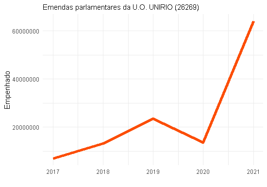

```{r, include=FALSE, warning=FALSE, message=FALSE}
options(htmltools.dir.version = FALSE)
knitr::opts_chunk$set(comment = "#>", echo=TRUE, fig.align='center')
```

class: inverse, middle
# Resumo Executivo  
1. Planejado (QDD) vs Executado  
2. Execução das Emendas Parlamentares 2017/2021  
3. Previsão de Emendas Parlamentares 2022  
4. Convênios da UNIRIO   
5. Próximos Passos  

---
class: inverse, center, middle
# Sobre o processo

```{r, echo=FALSE, fig.align='center', dpi=280}
#knitr::include_graphics("static/nos.png")
```

---
# Sobre o processo

- Comissão Permanente do QDD:
  
  - Reuniões uma vez por mês
  
  - Participação do Diretor de Orçamento e do Pró-reitor de Administração
  
- Objetivos:

  - Transparência Orçamentária 
  
  - Detalhamento das Emendas Parlamentares

---
# QDD e  Execução Orçamentária

- [http://www.unirio.br/qdd](http://www.unirio.br/qdd)


---
class: inverse, center, middle
# Emendas Parlamentares

Fonte dos dados: SIGA BRASIL

Valor real - Inflação IPCA     
PLOA + Créditos adicionais     
Por ano da execução da emenda     


---


```{r, echo=FALSE, message=FALSE, warning=FALSE, fig.align='center'}


```


---


```{r, echo=FALSE, message=FALSE, warning=FALSE, fig.align='center'}
knitr::include_graphics("C:/Users/Hp/Documents/GitHub/repositorio/emendas_parlamentares/Rplot03.png")

```

---
class: inverse, center, middle
# Emendas Parlamentares por Autor


---


```{r, echo=FALSE, message=FALSE, warning=FALSE, fig.align='center'}
knitr::include_graphics("C:/Users/Hp/Documents/GitHub/repositorio/emendas_parlamentares/Rplot04.png")

```


---
class: inverse, center, middle
# Emendas no Relatório de Gestão da Unirio

---

```{r, echo=FALSE, message=FALSE, warning=FALSE, fig.align='center'}
knitr::include_graphics("C:/Users/Hp/Documents/GitHub/repositorio/emendas_parlamentares/Imagem1.png")

```

---

```{r, echo=FALSE, message=FALSE, warning=FALSE, fig.align='center'}
knitr::include_graphics("C:/Users/Hp/Documents/GitHub/repositorio/emendas_parlamentares/Imagem2.png")

```


---


# Emendas Previstas para 2022

- [http://www.unirio.br/diretoriadeorcamento/orcamento/orcamento-2022-atualizado-em-07-01-2022](http://www.unirio.br/diretoriadeorcamento/orcamento/orcamento-2022-atualizado-em-07-01-2022)

- Fonte: Diretoria de Orçamento - UNIRIO

---

```{r, echo=FALSE, message=FALSE, warning=FALSE, fig.align='center'}
dados <-data.frame(
Emenda  = c(
"01.-.71200004.Bancada.RJ.pdf",
"02 - 13100010 Benedita da Silva.pdf",
"03 - 39410011 Chiquinho Brazão.pdf",
"04 - 39410012 Chiquinho Brazão.pdf",
"05 - 39930004 Gelson Azevedo.pdf",
"06 - 40130020 Gurgel.pdf","07 - 17750014 Jandira Feghali.pdf",
"08 - 40260022 Juninho do Pneu.pdf",
"09 - 13380007 Paulo Ramos.pdf",
"10 - 35780010 Rodrigo Maia.pdf","11 - 37990006 Romário.pdf",
"12 - 37560004 Rosangela Gomes.pdf",
"13 - 37660006 Sóstenes Cavalcante.pdf"),
Valor = c("R$ 133.170.000,00","R$ 1.250.000,00","R$ 2.100.000,00",
          "R$ 2.000.000,00","R$ 3.000.000,00","R$ 8.329.682,00",
          "R$ 270.000,00","R$ 1.000.000,00","R$ 750.000,00",
          "R$ 3.411.000,00","R$ 4.939.680,00","R$ 400.000,00",
          "R$ 2.000.000,00"),
Nome = c("UNIRIO.MEC" ,"Educação UNIRIO","Caravana Animal",
        "São João de Meriti - projeto cultural",
        "Emenda UNIRIO","Educação","Escola de Enfermagem",
        "UNIRIO","UNIRIO","RM UNIRIO",
        "20GK UNIRIO","Universidade Federal","UNIRIO")
)
library(kableExtra)
dados %>%
  kbl() %>%
  kable_paper("hover", full_width = F)
```

---
class: inverse, center, middle
# Convênios  da UNIRIO 


---
# Convênios  da UNIRIO 

- [De acordo com a UNIRIO](https://docs.google.com/spreadsheets/d/1foy_c6GuYQEuN8gEZwUp3tiVBtknHZlH0cu2rzgtsHY/edit#gid=0)
- [https://docs.google.com/spreadsheets/d/1foy_c6GuYQEuN8gEZwUp3tiVBtknHZlH0cu2rzgtsHY/edit#gid=0](https://docs.google.com/spreadsheets/d/1foy_c6GuYQEuN8gEZwUp3tiVBtknHZlH0cu2rzgtsHY/edit#gid=0)


- [De acordo com o Portal da Transparência](https://www.portaltransparencia.gov.br/orgaos/26269?ano=2021)
- [https://www.portaltransparencia.gov.br/orgaos/26269?ano=2021](https://www.portaltransparencia.gov.br/orgaos/26269?ano=2021)


